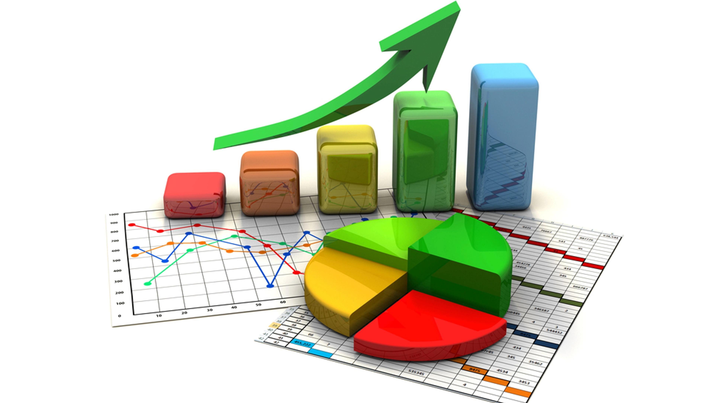
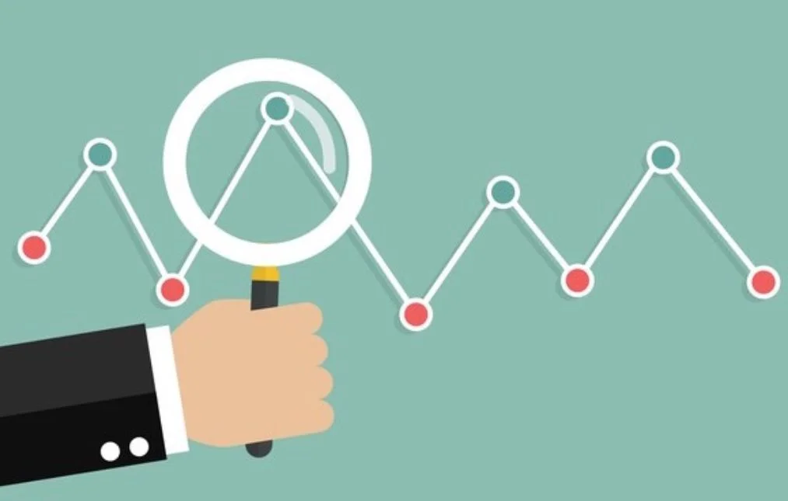
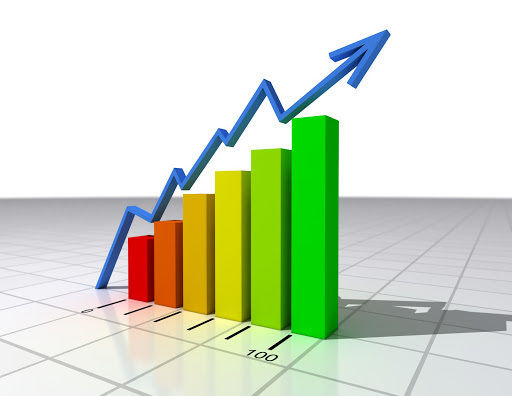

```{=html}
<div style="position:absolute; top:10px; right:10px;">

</div>
```

```{=html}
<style>
body{
  background-color:#f7f6ed;
  font-size:130%;
  text-align:justify;
}
</style>
```

# .Introducción

La estadística permite convertir datos en información útil. Está presente en actividades cotidianas y en áreas como la administración, la contabilidad, la economía, la salud, la educación y la ingeniería. Por ejemplo, una empresa puede utilizarla para conocer cuánto vende, comparar su producción entre meses, estudiar la satisfacción de sus clientes o estimar la demanda de un producto.


# .Historia de la estadística

{width=100% fig-align="center"}

**Origen y evolución**

La estadística no apareció de un momento a otro. Surgió de la necesidad de las comunidades y los gobiernos de contar personas, animales, tierras, cosechas y bienes. Con el paso del tiempo, esas actividades sencillas de registro se convirtieron en procedimientos organizados para analizar e interpretar información.

Los primeros registros se realizaban mediante marcas, dibujos y símbolos sobre piedras, madera, pieles y paredes de cuevas. Estas representaciones permitían llevar cuentas de personas, animales y objetos. La información histórica sobre estos usos se conoce por medio de crónicas, documentos escritos y restos arqueológicos (Salgado Horta, s. f.-a, pp. 2–6).

**Principales momentos históricos**

| Época o civilización | Aporte o uso de los registros |
|---|---|
| Comunidades prehistóricas | Utilizaban marcas y representaciones gráficas para contar personas, animales y otros elementos. |
| Babilonia, alrededor de 3000 a. C. | Registraban en tablillas de arcilla datos sobre producción agrícola y productos vendidos o intercambiados mediante trueque. |
| Egipto antiguo | Recopilaban información sobre población y riqueza del territorio. También realizaban censos para apoyar la administración. |
| Asiria | Reunía registros históricos, religiosos, económicos y datos relacionados con producción y cuentas. |
| China antigua | Realizaba censos y recopilaba información agrícola, industrial y comercial. |
| Grecia | Recopilaba datos sobre distribución de tierras, servicio militar, impuestos y recursos disponibles. |
| Imperio romano | Organizó censos periódicos y registros de nacimientos, defunciones, matrimonios, ganado y riquezas. |
| Edad Media | La actividad estadística disminuyó en comparación con la época romana, aunque se conservaron registros de tierras y bienes, especialmente por instituciones religiosas y gobiernos. |
| Civilización inca | Utilizó los quipus, un sistema de cordones y nudos de distintos colores, para registrar información sobre población y acontecimientos. |
| Siglos XVI y XVII | Se fortalecieron los registros de nacimientos y defunciones y el análisis de datos demográficos. |
| Siglos XVII y XVIII | Se desarrolló la teoría de la probabilidad, que amplió las posibilidades de análisis estadístico. |
| Siglo XIX | Se desarrollaron herramientas matemáticas como la teoría de los errores de observación y el método de mínimos cuadrados. |
| Época contemporánea | La estadística se aplica a numerosas ciencias y actividades económicas y sociales. La informática facilita procesar grandes volúmenes de datos y construir representaciones gráficas. |

**Algunos aportes destacados**

- **Babilonios:** las tablillas de arcilla permitían registrar la producción y las transacciones comerciales.
- **Egipcios:** los censos y registros de población y riqueza contribuían a la organización del territorio.
- **Griegos y romanos:** utilizaron la información para fines tributarios, sociales, militares y administrativos.
- **Incas:** los quipus muestran que también existieron sistemas de registro de información sin escritura alfabética.
- **John Graunt:** en 1662 analizó registros de mortalidad de Londres y realizó observaciones sobre nacimientos y defunciones.
- **Edmond Halley:** aplicó procedimientos de análisis al estudio de la duración de la vida humana; sus cálculos contribuyeron al desarrollo de las tablas de mortalidad.
- **Desarrollo de la probabilidad:** los trabajos de matemáticos como Bernoulli, Laplace y otros permitieron estudiar la incertidumbre y fortalecer la inferencia estadística.
- **Informática:** los computadores transformaron la forma de almacenar, procesar, analizar y representar datos.

La historia presentada en el material de clase muestra una evolución desde los censos y los registros administrativos hasta el análisis matemático, la probabilidad y el uso de herramientas informáticas (Salgado Horta, s. f.-a, pp. 7–39).

**La estadística en la actualidad**

Actualmente, la estadística no se limita a contar o presentar datos. También busca interpretarlos y utilizarlos para comprender situaciones y tomar decisiones. Por ejemplo:

- Una empresa analiza sus ventas para identificar los productos con mayor demanda.
- Un hospital estudia los tiempos de atención para detectar demoras.
- Una universidad revisa los resultados académicos para identificar necesidades de apoyo.
- Una entidad pública analiza información de la población para planear inversiones.
- Una fábrica utiliza muestras para revisar la calidad de sus productos.

# .Conceptos 

{width=85% fig-align="center"}

Si quieres que ocupe todo el ancho disponible:

**¿Qué es la estadística?**

La estadística es la ciencia que recoge, organiza, presenta, analiza e interpreta datos con el propósito de obtener información y apoyar una toma de decisiones más eficaz (Salgado Horta, s. f.-b, p. 2).

En términos sencillos, permite pasar de una cantidad de datos a una explicación comprensible de lo que está sucediendo.

## Tipos de estadística

**Estadística descriptiva**

Es el conjunto de métodos que permite organizar, resumir y presentar los datos de forma clara e informativa. Utiliza tablas, gráficos y medidas como promedios, porcentajes, mínimos y máximos.

**Ejemplo:** una tienda reúne las ventas de los últimos seis meses y presenta una tabla y un gráfico para mostrar cuánto vendió en cada mes. Está describiendo los datos observados.

## .Estadística inferencial

Utiliza la información obtenida de una muestra para estudiar o estimar características de una población. También permite realizar pronósticos, siempre considerando la incertidumbre propia de trabajar con una parte de la población.

**Ejemplo:** una empresa encuesta a 200 clientes seleccionados de manera adecuada para estimar el nivel de satisfacción de todos sus clientes.

La diferencia central es que la estadística descriptiva resume los datos disponibles, mientras que la inferencial utiliza los resultados de una muestra para obtener conclusiones sobre una población (Salgado Horta, s. f.-b, pp. 3–4).

**Población**

Es el conjunto completo de individuos, objetos o elementos que son de interés en un estudio. También puede entenderse como el conjunto de todas las mediciones que podrían obtenerse de esos elementos.

**Ejemplo:** si se desea estudiar la satisfacción de los estudiantes de una universidad, la población está formada por todos los estudiantes matriculados en el periodo definido.

**Muestra**

Es una parte o porción de la población seleccionada para realizar el estudio. Para que los resultados puedan representar a la población, la selección debe ser apropiada para el objetivo de la investigación.

**Ejemplo:** de una universidad con 5.000 estudiantes se seleccionan 300 para responder una encuesta de satisfacción.

Se recurre a muestras porque estudiar a toda la población puede requerir demasiado tiempo, dinero y recursos. En algunos casos, revisar todos los elementos puede ser imposible o destruir el producto que se quiere evaluar, como ocurre en ciertas pruebas de control de calidad (Salgado Horta, s. f.-b, pp. 5–7).

**Elemento o individuo**

Es cada unidad que forma parte de la población y sobre la cual se obtiene información.

**Ejemplo:** en un estudio sobre los trabajadores de una empresa, cada trabajador es un elemento o individuo.

**Dato**

Es el valor o la respuesta que se obtiene al observar o medir una característica de un elemento.

**Ejemplo:** si se registra la edad de un trabajador y el resultado es 28 años, ese valor es un dato.

**Variable**

Es la característica que se estudia y cuyos valores pueden cambiar entre los elementos observados. La información recolectada durante un estudio se almacena en variables para poder clasificarla, ordenarla, analizarla y presentarla (Salgado Horta, s. f.-c, p. 2).

**Ejemplos:** edad, estatura, estado civil, tipo de contrato, número de ventas y salario.

## Parámetro y estadístico

- **Parámetro:** es una medida numérica que describe una característica de toda la población. Por ejemplo, el promedio real de edad de todos los trabajadores de una empresa.
- **Estadístico:** es una medida calculada con los datos de una muestra. Por ejemplo, el promedio de edad de 50 trabajadores seleccionados.

El estadístico puede utilizarse para estimar el parámetro de la población.

**Censo**

Es el proceso de recolectar información de todos los elementos de una población. Por ejemplo, registrar las características de todos los estudiantes matriculados en una institución durante un periodo determinado.

## Instrumentos y fuentes de recolección

La información estadística puede obtenerse mediante diferentes instrumentos y procedimientos:

- Encuestas.
- Entrevistas.
- Cuestionarios.
- Observación.
- Controles de calidad.
- Reportes de producción.

La elección depende de la información que se necesita y de las características del estudio (Salgado Horta, s. f.-b, p. 8).

# .Variables estadísticas

{width=85% fig-align="center"}

**¿Para qué sirven las variables?**

En una investigación, las variables permiten guardar y organizar la información de cada elemento observado. Por ejemplo, en una base de datos de empleados se pueden registrar la edad, el cargo, el salario, el área de trabajo y la antigüedad.

Una variable representa una característica; los datos son los valores concretos que toma esa característica en cada observación.

## .Clasificación según su naturaleza

Las variables se clasifican principalmente en cualitativas y cuantitativas. Las cuantitativas, a su vez, pueden ser discretas o continuas (Salgado Horta, s. f.-c, pp. 3–10).

**Variables cualitativas**

Representan cualidades, atributos o categorías. Generalmente no expresan una cantidad numérica. Aunque algunas categorías se codifiquen con números, esos números no necesariamente representan una medida.

**Ejemplos:**

- Estado civil: soltero, casado, separado.
- Tipo de automóvil: automóvil, camioneta, camión.
- Marca de computador: Dell, HP, Apple.
- Color de ojos: café, verde, azul.
- Área de trabajo: contabilidad, ventas, producción.

**Importante:** si una empresa asigna el código 1 a Contabilidad, 2 a Ventas y 3 a Producción, la variable sigue siendo cualitativa. Los números funcionan como etiquetas y no indican cantidades ni jerarquías.

**Variables cuantitativas**

Expresan cantidades numéricas que se pueden contar o medir. Por ejemplo, edad, salario, número de empleados, estatura o cantidad de productos vendidos.

Se dividen en dos grupos:

**Cuantitativas discretas**

Son variables que resultan de contar elementos. Sus valores suelen ser números enteros, porque no tiene sentido contar una fracción de individuo u objeto en el contexto del conteo.

**Ejemplos:**

- Número de empleados de una empresa.
- Cantidad de camas de un hospital.
- Número de clientes atendidos en un día.
- Cantidad de cajas producidas.
- Número de vehículos que ingresan a un parqueadero.

**Cuantitativas continuas**

Son variables que resultan de medir. Pueden tomar valores decimales dentro de un intervalo, dependiendo de la precisión del instrumento utilizado.

**Ejemplos:**

- Estatura de una persona.
- Peso de un producto.
- Temperatura de un paciente.
- Tiempo que tarda un proceso.
- Litros de combustible en un tanque.

## .Esquema general de clasificación

```text
VARIABLES
├── Cualitativas
│   ├── Nominales
│   └── Ordinales
└── Cuantitativas
    ├── Discretas
    └── Continuas
```

La naturaleza de una variable y su escala de medición son dos criterios relacionados, pero no idénticos. La naturaleza indica si la característica es categórica o numérica; la escala indica qué tipo de comparación y operación tiene sentido realizar con sus valores.

# .Escalas de medición

{width=85% fig-align="center"}

Los niveles de medición describen cómo se clasifican o cuantifican los datos y ayudan a determinar qué operaciones y análisis estadísticos son adecuados. Los cuatro niveles más utilizados son nominal, ordinal, intervalo y razón (Salgado Horta, s. f.-c, pp. 11–18).

**Escala nominal**

Clasifica los datos en categorías que funcionan como nombres o etiquetas. No existe un orden natural entre las categorías.

**Ejemplos:**

- Tipo de contrato: fijo, indefinido, prestación de servicios.
- Área de una empresa: contabilidad, ventas, producción.
- Grupo sanguíneo: A, B, AB, O.
- Marca de vehículo: Renault, Chevrolet, Mazda.

Se pueden contar las observaciones de cada categoría y calcular frecuencias o porcentajes. No tiene sentido calcular un promedio de las categorías.

**Escala ordinal**

Clasifica los datos en categorías que sí tienen un orden o jerarquía. Sin embargo, la distancia entre una categoría y otra no necesariamente es igual.

**Ejemplos:**

- Nivel educativo: primaria, secundaria, técnico, universitario.
- Satisfacción: muy insatisfecho, insatisfecho, neutral, satisfecho, muy satisfecho.
- Nivel de riesgo: bajo, medio, alto.
- Puesto en una competencia: primero, segundo, tercero.

Es posible ordenar las categorías, pero no se puede asegurar que la diferencia entre dos niveles consecutivos sea siempre la misma.

**Escala de intervalo**

Es una escala numérica en la que las diferencias entre valores tienen significado y son comparables. Sin embargo, el cero no representa la ausencia absoluta de la característica.

**Ejemplo clásico:** temperatura en grados Celsius. La diferencia entre 10 °C y 20 °C es igual a la diferencia entre 20 °C y 30 °C, pero 20 °C no significa que exista el doble de temperatura que a 10 °C.

Otro ejemplo habitual es el año del calendario: la diferencia entre 2000 y 2010 es de diez años, pero el año 2000 no representa ausencia de tiempo.

**Escala de razón**

Es una escala numérica con intervalos iguales y un cero absoluto, que representa ausencia de la cantidad medida. Permite comparar diferencias y proporciones.

**Ejemplos:**

- Peso en kilogramos.
- Estatura en centímetros.
- Distancia en kilómetros.
- Tiempo de duración de una actividad.
- Ingresos en pesos.
- Número de unidades vendidas.

Por ejemplo, un producto de 10 kg pesa el doble que uno de 5 kg. La comparación tiene sentido porque el peso posee un cero absoluto.

## Cuadro comparativo de las escalas

| Escala | ¿Clasifica? | ¿Tiene orden? | ¿Diferencias comparables? | ¿Cero absoluto? | Ejemplo |
|---|---:|---:|---:|---:|---|
| Nominal | Sí | No | No | No aplica | Área de trabajo |
| Ordinal | Sí | Sí | No necesariamente | No aplica | Nivel de satisfacción |
| Intervalo | Sí, si se agrupa | Sí | Sí | No | Temperatura °C |
| Razón | Sí, si se agrupa | Sí | Sí | Sí | Peso, salario, distancia |

## Relación entre naturaleza y escala

| Variable | Naturaleza | Clasificación o escala | Justificación |
|---|---|---|---|
| Estado civil | Cualitativa | Nominal | Son categorías sin orden. |
| Nivel educativo | Cualitativa | Ordinal | Sus categorías tienen jerarquía. |
| Temperatura en °C | Cuantitativa continua | Intervalo | Las diferencias son comparables, pero el cero no es absoluto. |
| Salario mensual | Cuantitativa continua | Razón | Tiene cero absoluto y permite comparar proporciones. |
| Número de empleados | Cuantitativa discreta | Razón | Es un conteo con cero absoluto. |
| Estatura | Cuantitativa continua | Razón | Es una medición con cero absoluto. |
| Puesto en una competencia | Cualitativa | Ordinal | Indica una posición ordenada, no una distancia numérica. |
| Código de empleado | Cualitativa | Nominal | El número identifica a la persona, no mide una cantidad. |

# Aplicación práctica en R

{width=85% fig-align="center"}

R es un lenguaje y entorno de programación utilizado para el análisis estadístico, la manipulación de datos y la elaboración de gráficos. En esta sección se presentan ejemplos básicos para crear variables, reconocer sus tipos y obtener resúmenes.

**Crear una base de datos de ejemplo**

Supongamos que se desea analizar información de algunos trabajadores de una empresa. La siguiente base contiene datos ficticios con fines académicos.

```{r}
trabajadores <- data.frame(
  empleado = c("E01", "E02", "E03", "E04", "E05", "E06"),
  area = c("Contabilidad", "Ventas", "Produccion",
           "Ventas", "Contabilidad", "Produccion"),
  nivel_educativo = c("Tecnico", "Universitario", "Secundaria",
                      "Tecnico", "Universitario", "Secundaria"),
  edad = c(22, 29, 35, 24, 31, 27),
  salario = c(1800000, 2500000, 2100000,
              1950000, 2800000, 2050000),
  hijos = c(0, 1, 2, 0, 1, 0),
  horas_trabajadas = c(44, 42, 45, 40, 43, 44)
)

trabajadores
```

**Identificar la naturaleza de las variables**

En la base anterior se pueden identificar los siguientes tipos:

- `empleado`: cualitativa nominal, porque es un código de identificación.
- `area`: cualitativa nominal, porque representa categorías sin orden.
- `nivel_educativo`: cualitativa ordinal, porque sus categorías pueden organizarse por nivel.
- `edad`: cuantitativa; en este ejemplo está registrada en años enteros.
- `salario`: cuantitativa, de escala de razón.
- `hijos`: cuantitativa discreta, porque cuenta personas.
- `horas_trabajadas`: cuantitativa; si se mide con fracciones de hora, puede tratarse como continua.

**Revisar la estructura de los datos**

```{r}
str(trabajadores)
```

La función `str()` muestra la estructura del objeto, el número de observaciones y el tipo de dato que R reconoce para cada columna. Es importante recordar que el tipo de almacenamiento de R no reemplaza la clasificación estadística: una variable codificada como número puede ser cualitativa.

**Convertir categorías en factores**

En R, las variables categóricas se pueden almacenar como factores. Para una variable ordinal se pueden definir explícitamente sus niveles y su orden.

```{r}
trabajadores$area <- factor(trabajadores$area)

trabajadores$nivel_educativo <- factor(
  trabajadores$nivel_educativo,
  levels = c("Secundaria", "Tecnico", "Universitario"),
  ordered = TRUE
)

str(trabajadores)
```

**Obtener frecuencias de una variable cualitativa**

```{r}
table(trabajadores$area)
prop.table(table(trabajadores$area))
```

`table()` cuenta cuántas observaciones hay en cada categoría. `prop.table()` calcula la proporción que representa cada categoría respecto al total.

**Resumir variables cuantitativas**

```{r}
summary(trabajadores$salario)

mean(trabajadores$salario)
median(trabajadores$salario)
sd(trabajadores$salario)
```

Estas funciones permiten obtener un resumen básico:

- `summary()`: muestra valores mínimos, máximos, cuartiles y promedio.
- `mean()`: calcula la media.
- `median()`: calcula la mediana.
- `sd()`: calcula la desviación estándar.

**Construir un gráfico sencillo**

```{r}
barplot(
  table(trabajadores$area),
  main = "Trabajadores por área",
  xlab = "Área",
  ylab = "Número de trabajadores"
)
```

El gráfico de barras permite comparar la cantidad de trabajadores registrada en cada área.

**Ejemplo de clasificación de variables en R**

La clasificación estadística debe definirse según el significado de cada variable y no solamente según la forma en que aparece almacenada en el programa.

```{r}
clasificacion <- data.frame(
  variable = c("area", "nivel_educativo", "edad",
               "salario", "hijos", "horas_trabajadas"),
  naturaleza = c("Cualitativa", "Cualitativa",
                 "Cuantitativa", "Cuantitativa",
                 "Cuantitativa", "Cuantitativa"),
  tipo = c("Nominal", "Ordinal", "Discreta en este registro",
           "Continua", "Discreta", "Continua si admite fracciones"),
  escala = c("Nominal", "Ordinal", "Razón",
             "Razón", "Razón", "Razón")
)

clasificacion
```

# Ejercicio de aplicación

{fig-align="center" width="80%"}

Una empresa de distribución desea conocer las características de sus trabajadores y organizar una base de datos para tomar decisiones administrativas.

Clasifique las siguientes variables según su naturaleza, tipo y escala de medición:

1. Área en la que trabaja cada empleado.
2. Número de pedidos atendidos durante el día.
3. Salario mensual.
4. Nivel de satisfacción con el ambiente laboral.
5. Tiempo empleado para entregar un pedido.
6. Código asignado a cada trabajador.
7. Temperatura del área de almacenamiento en grados Celsius.

**Solución orientativa**

| Variable | Naturaleza | Tipo | Escala |
|---|---|---|---|
| Área de trabajo | Cualitativa | Nominal | Nominal |
| Número de pedidos | Cuantitativa | Discreta | Razón |
| Salario mensual | Cuantitativa | Continua | Razón |
| Nivel de satisfacción | Cualitativa | Ordinal | Ordinal |
| Tiempo de entrega | Cuantitativa | Continua | Razón |
| Código del trabajador | Cualitativa | Nominal | Nominal |
| Temperatura en °C | Cuantitativa | Continua | Intervalo |

La clasificación puede depender de cómo se registre la información. Por ejemplo, la edad registrada en años cumplidos es discreta en la base de datos, aunque la edad como tiempo transcurrido puede medirse de manera continua.

# Conclusiones

La estadística ha evolucionado desde los primeros registros y censos de las civilizaciones antiguas hasta convertirse en una herramienta fundamental para analizar información y apoyar decisiones. Su desarrollo ha estado relacionado con las necesidades de organización de las sociedades, el avance de las matemáticas, la teoría de la probabilidad y la informática.

Los conceptos de población, muestra, individuo, dato y variable son fundamentales para estructurar correctamente una investigación. También es importante distinguir entre estadística descriptiva, que organiza y resume la información, e inferencial, que permite estudiar una población a partir de una muestra.

Por otra parte, clasificar correctamente las variables ayuda a elegir la forma adecuada de recolectar, organizar y analizar los datos. Las variables pueden ser cualitativas o cuantitativas; estas últimas se dividen en discretas y continuas. Las escalas nominal, ordinal, de intervalo y de razón permiten comprender qué comparaciones y operaciones tienen sentido en cada caso.

Finalmente, R facilita el trabajo estadístico porque permite organizar bases de datos, calcular medidas, elaborar tablas y construir gráficos. Sin embargo, el análisis correcto comienza antes de programar: es necesario comprender qué representa cada variable y cómo fue medida.

# .Referencias 

Salgado Horta, D. (s. f.-a). *Historia de la estadística* [Material de clase, 40 páginas].

Salgado Horta, D. (s. f.-b). *Estadística: introducción - tipos de datos. Período 2026-1* [Material de clase, 14 páginas].

Salgado Horta, D. (s. f.-c). *Estadística: variables, niveles de medición. Período 2026-1* [Material de clase, 20 páginas].

R Core Team. (2026). *R: A language and environment for statistical computing*. R Foundation for Statistical Computing. https://www.R-project.org/

---

**Nota académica:** los contenidos históricos y las definiciones principales se organizaron tomando como referencia los tres materiales de clase suministrados. Los ejemplos empresariales y el código de R se incorporaron como apoyo didáctico para aplicar los conceptos.
